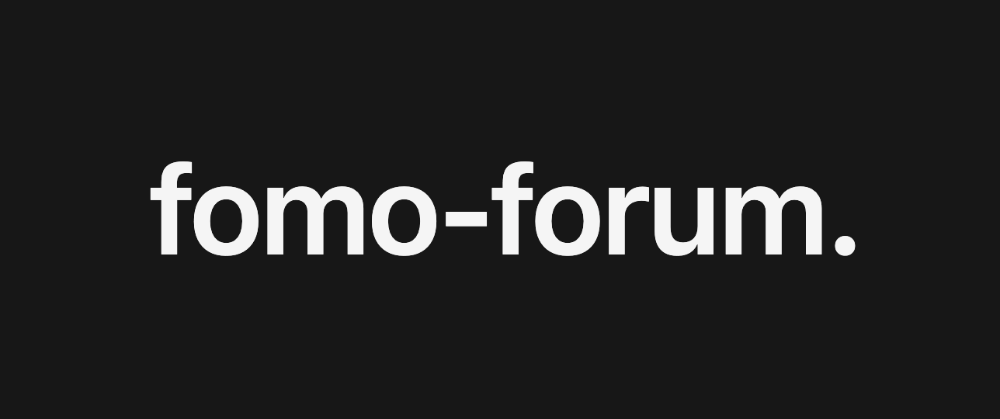

<h1 align="center">Fomo - Forum</h1>

  
  
  
  
  

> REST API для тематических обсуждений на ASP.NET Core, PostgreSQL и Redis.

Web Forum предоставляет пользователей, категории, темы, сообщения, реакции, избранное и инструменты модерации. Backend работает вместе с [frontend-репозиторием](https://github.com/dysthmia/web-forum-frontend).

## Возможности

- **Пользователи и авторизация** — JWT access-токены, refresh-сессии, профили и роли.
- **Категории и темы** — создание, ответы, редактирование и soft delete.
- **Реакции и избранное** — лайки, дизлайки и сохранённые темы.
- **Полнотекстовый поиск** — русские и английские тексты через PostgreSQL.
- **Модерация** — жалобы, управление темами, временные и бессрочные блокировки.
- **Redis** — кэширование, подсчёт уникальных просмотров и rate limiting.

## Документация

| Раздел | Описание |
| --- | --- |
| [База данных](docs/database/README.md) | PostgreSQL, Redis и диаграммы keyspace/ER. |
| [Быстрый старт](docs/quick-start/README.md) | Локальный запуск, Compose, команды, конфигурация и тесты. |
| [Frontend](https://github.com/dysthmia/web-forum-frontend) | Клиентское приложение форума. |
