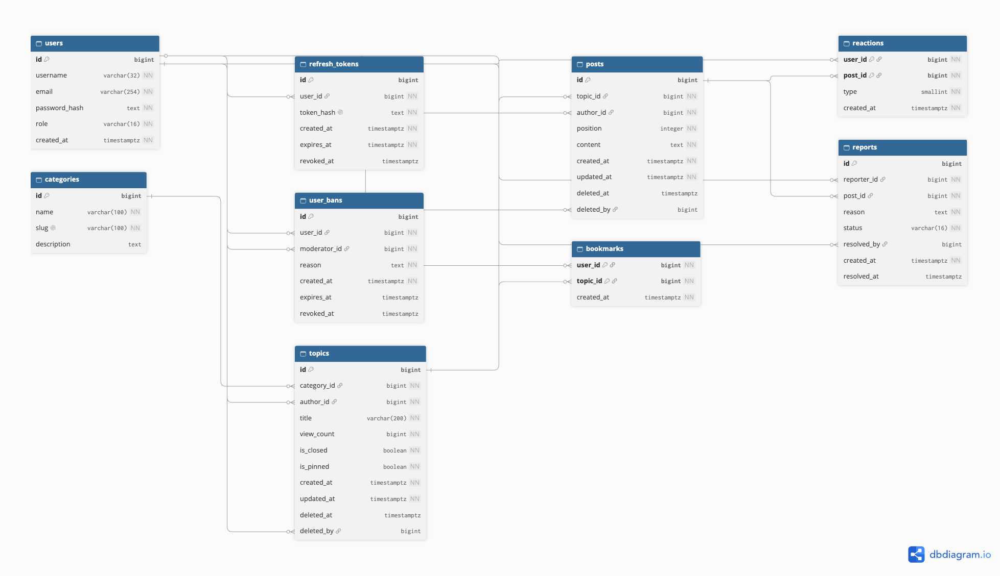

# База данных

В проекте используются PostgreSQL 16 для постоянных данных и Redis для временных данных, кеша и управления нагрузкой.

## PostgreSQL

PostgreSQL хранит и защищает целостность следующих данных:

1. Пользователи, роли и авторизация.
2. Refresh-токены и история блокировок.
3. Категории, темы и сообщения.
4. Реакции, избранное и жалобы.

### ER-диаграмма

Исходный код диаграммы для dbdiagram.io расположен в [dbdiogram.md](../dbdiogram.md).

## Redis

Redis используется только для временных данных:

- кеширования категорий и страниц тем;
- дедупликации уникальных просмотров и временных счётчиков;
- rate limit для входа и публикации контента.

Подробная модель Redis-ключей, TTL и связей с `topics.view_count`: [Redis keyspace ER diagram](../redis-er-diagram.md).
