# Redis keyspace ER diagram

Redis в проекте не хранит доменную истину и не имеет таблиц. Эта диаграмма описывает реальные шаблоны ключей, типы Redis, TTL и логические связи.

```mermaid
erDiagram
    POSTGRES_TOPIC {
        bigint id PK
        bigint view_count
    }

    CATEGORY_CACHE {
        string key "{CACHE_KEY_PREFIX}:categories"
        string json "CategoryResponse[]"
        duration ttl "CACHE_TTL_SECONDS"
    }

    CATEGORY_TOPIC_CACHE {
        string key "{CACHE_KEY_PREFIX}:category:{categoryId}:topics:{sort}:{page}:{pageSize}"
        string json "PagedResponse<TopicListItemResponse>"
        duration ttl "CACHE_TTL_SECONDS"
    }

    CATEGORY_CACHE_TAG {
        string key "{CACHE_KEY_PREFIX}:category:{categoryId}:keys"
        set members "CATEGORY_TOPIC_CACHE keys"
        duration ttl "CACHE_TTL_SECONDS"
    }

    VIEW_SEEN {
        string key "{VIEW_SEEN_KEY_PREFIX}:{topicId}:{visitorHash}"
        string value "1"
        duration ttl "VIEW_WINDOW_MINUTES"
    }

    VIEW_COUNTER {
        string key "{VIEW_COUNTER_KEY_PREFIX}:{topicId}"
        integer value "pending view delta"
        duration ttl "none; removed after flush"
    }

    DIRTY_TOPICS {
        string key "{VIEW_DIRTY_TOPICS_KEY}"
        set members "topicId"
        duration ttl "none; member removed after flush"
    }

    LOGIN_RATE_LIMIT {
        string key "{RATE_LIMIT_KEY_PREFIX}:login:{sha256(normalizedIdentity)}"
        integer value "request count"
        duration ttl "LOGIN_RATE_LIMIT_WINDOW_SECONDS"
    }

    CONTENT_RATE_LIMIT {
        string key "{RATE_LIMIT_KEY_PREFIX}:content:{userId}"
        integer value "request count"
        duration ttl "CONTENT_RATE_LIMIT_WINDOW_SECONDS"
    }

    CATEGORY_CACHE_TAG ||--o{ CATEGORY_TOPIC_CACHE : invalidates
    POSTGRES_TOPIC ||--o{ VIEW_SEEN : deduplicates
    POSTGRES_TOPIC ||--|| VIEW_COUNTER : accumulates
    DIRTY_TOPICS ||--o{ VIEW_COUNTER : marks_for_flush
    VIEW_COUNTER }o--|| POSTGRES_TOPIC : increments_view_count
```

## Операции

| Область | Чтение и запись | Атомарность и очистка |
| --- | --- | --- |
| Кеш категорий | `CATEGORY_CACHE` хранит сериализованные категории. Страницы тем категории добавляются в `CATEGORY_CACHE_TAG`. | Все cache values и tags используют `CACHE_TTL_SECONDS`; при инвалидировании категории удаляются все ключи из тега, затем сам тег. |
| Счётчик просмотров | Lua-скрипт создаёт `VIEW_SEEN` через `SET NX EX`; только новый посетитель увеличивает `VIEW_COUNTER` и добавляет тему в `DIRTY_TOPICS`. | Фоновый сервис атомарно забирает дельту, удаляет участника dirty set, затем прибавляет значение в PostgreSQL. Сбой между получением дельты и обновлением PostgreSQL может привести к её небольшой потере — это допускается v1. |
| Rate limit входа | Lua-скрипт увеличивает `LOGIN_RATE_LIMIT`; первое увеличение назначает TTL окна. | Часть ключа с идентификатором нормализуется и хешируется SHA-256 до записи в ключ. |
| Rate limit публикаций | Тот же Lua-скрипт увеличивает ключ для аутентифицированного `userId`. | Ключ истекает по окончании заданного окна создания контента. |

## Границы использования

- Refresh-токены, JWT, профили пользователей и доменные записи **не** хранятся в Redis.
- `{...}` обозначает значение времени выполнения; все префиксы и TTL берутся из `RedisOptions`, основанных на переменных окружения.
- `visitorHash` — SHA-256-хеш ID аутентифицированного пользователя либо HttpOnly-cookie гостя; исходное значение посетителя не входит в Redis-ключ.
